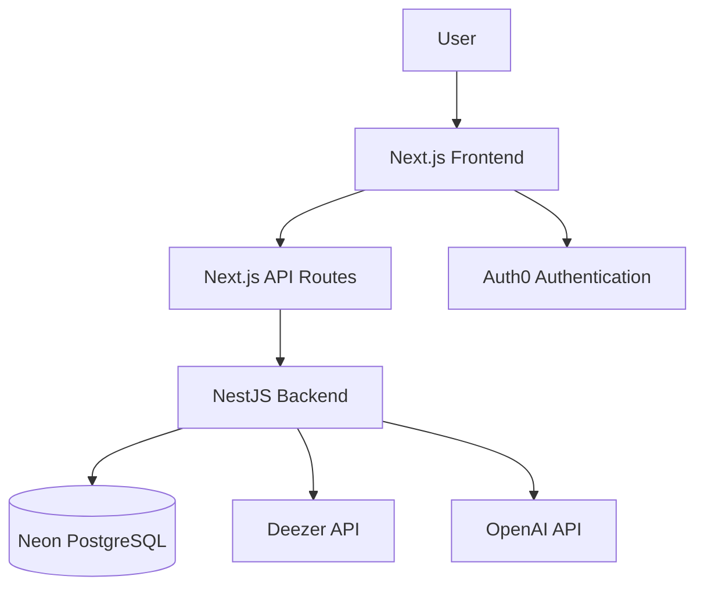
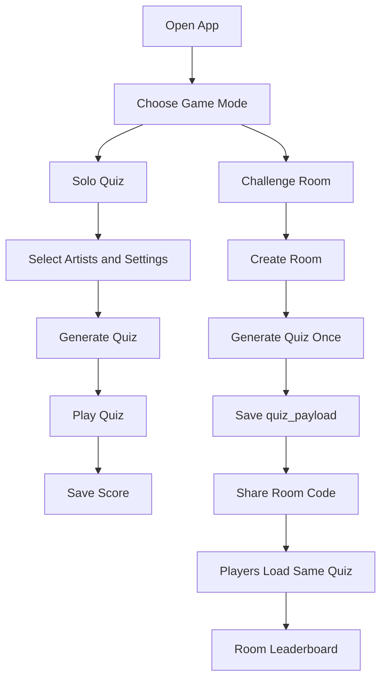

# BeatGuess

**BeatGuess** is a full-stack music quiz web app where players listen to short music previews and guess the correct song, artist, or album.

The app supports solo quizzes, asynchronous challenge rooms, persistent leaderboards, Auth0 authentication, PostgreSQL storage, and AI-assisted typed answer validation.

---

## Live Demo

| Service | URL |
|---|---|
| Frontend | https://beatguess-rho.vercel.app |
| Backend API | https://beatguess.onrender.com |

---

## Overview

BeatGuess was built as a full-stack TypeScript project to combine real product logic with modern web development practices.

The app has two main gameplay modes:

- **Solo Quiz** — players create a custom quiz and play alone.
- **Challenge Rooms** — players create a room, share a code or invite link, and compete on the same quiz.

The core technical idea behind the challenge mode is fairness:

```text
Same room = same questions for every player.
Different room = newly generated quiz.
```

When a challenge room is created, the quiz is generated once and stored in the database as `quiz_payload`. Every player inside the same room loads that saved quiz, so the competition stays fair.

---

## Key Features

- Custom artist-based quiz generation
- Multiple-choice and typed-answer modes
- Song, artist, album, and mixed question types
- Easy, medium, and hard difficulty levels
- Auth0 login and user accounts
- Personal score history and global leaderboard
- Challenge rooms with shareable room codes
- Room-specific leaderboards
- Fixed quiz payloads for fair multiplayer
- AI-assisted typed answer validation
- Frontend and backend deployment

---

## Tech Stack

### Frontend

- Next.js
- React
- TypeScript
- Tailwind CSS
- Vercel

### Backend

- NestJS
- TypeScript
- PostgreSQL
- Neon
- Render

### Other Services

- Auth0 for authentication
- OpenAI API for optional AI validation
- Deezer data for artist and track previews

---

## Architecture



---

## Main User Flow



---

## Challenge Room Logic

The most important technical feature is the challenge room system.

A normal quiz generator can create unfair multiplayer behavior:

```text
Player 1 starts the challenge → gets Quiz A
Player 2 starts the challenge → gets Quiz B
```

BeatGuess solves this by generating the quiz once when the room is created and saving it as `quiz_payload`.

```text
Create room
→ generate quiz once
→ save quiz_payload
→ every player loads the same saved quiz
```

This means:

```text
Same room = same quiz.
New room = new quiz.
```

This makes asynchronous multiplayer fair while keeping every new challenge unique.

---

## AI-Assisted Typed Answer Validation

Typed answers are validated with a hybrid system.

The app first uses rule-based validation to handle:

- Accents
- Punctuation
- Uppercase/lowercase differences
- Small typos
- Featuring artists
- Remix, live, and remastered text

If the answer is still ambiguous and AI validation is enabled, the backend can use the OpenAI API as a fallback.

Example:

```text
Official title: Dégaine
User answer: degaine
Result: accepted
```

```text
Official title: Mwaka Moon (feat. Damso)
User answer: mwaka moon
Result: accepted
```

AI is only used when needed, which keeps the system faster, cheaper, and easier to control.

---

## Repository Structure

```text
beatguess/
  apps/
    web/      # Next.js frontend
    api/      # NestJS backend
  docs/
  README.md
```

Important frontend routes:

```text
/                     # Landing page
/play                 # Game mode selection
/quiz/custom-mix      # Solo quiz setup
/quiz/play            # Main quiz gameplay
/challenge            # Create or join challenge room
/challenge/[roomCode] # Challenge room page
/scores               # Scores and leaderboard
/account              # User account page
```

Important backend modules:

```text
music/              # Artist and track data
quiz/               # Quiz generation
scores/             # Score saving and leaderboard
challenges/         # Challenge rooms and room scores
answer-validation/  # Typed answer validation
database/           # PostgreSQL connection
```

---

## Local Development

### Backend

```powershell
cd apps/api
pnpm install
pnpm start:dev
```

Backend runs on:

```text
http://localhost:4000
```

### Frontend

```powershell
cd apps/web
pnpm install
pnpm dev
```

Frontend runs on:

```text
http://localhost:3000
```

---

## Environment Variables

### Backend

```env
DATABASE_URL=postgresql://...
INTERNAL_API_SECRET=your_internal_secret
OPENAI_API_KEY=your_openai_api_key
AI_VALIDATION_ENABLED=true
AI_VALIDATION_MODEL=gpt-5-nano
```

### Frontend

```env
NEXT_PUBLIC_API_URL=http://localhost:4000
AUTH0_DOMAIN=...
AUTH0_CLIENT_ID=...
AUTH0_CLIENT_SECRET=...
AUTH0_SECRET=...
APP_BASE_URL=http://localhost:3000
INTERNAL_API_SECRET=your_internal_secret
```

Important:

```text
Never commit .env files.
Never expose OPENAI_API_KEY in the frontend.
```

---

## Roadmap

### Completed

- Core solo quiz mode
- Multiple-choice mode
- Typed-answer mode
- Auth0 authentication
- PostgreSQL score persistence
- Global leaderboard
- Challenge room creation
- Fixed quiz payload per room
- Room leaderboard
- AI-assisted answer validation setup
- Frontend and backend deployment

### In Progress

- UI polish
- Mobile improvements
- Cleaner result screen
- Better challenge room experience
- Better loading and error states

### Planned

- Automated tests
- Daily challenge mode
- Practice mode
- Ranked mode
- User achievements
- Better statistics
- Admin dashboard

---

## What I Learned

Through this project, I practiced:

- Building a full-stack TypeScript application
- Structuring a monorepo
- Creating frontend routes with Next.js
- Building backend modules with NestJS
- Connecting a PostgreSQL database
- Implementing Auth0 authentication
- Saving and loading user scores
- Designing fair asynchronous challenge rooms
- Protecting backend routes with internal secrets
- Integrating AI as a backend feature
- Deploying frontend and backend separately

---

## Development Approach

This project was developed with an AI-assisted workflow.

AI was used as a coding and debugging assistant, while the product direction, testing, feature decisions, deployment process, and final integration were guided by the developer.

The next focus is code ownership: understanding the key files, functions, and implementation decisions well enough to explain and extend the project confidently.

---

## Core Technical Highlight

The strongest technical feature of BeatGuess is the challenge room system:

```text
Every new room generates a unique quiz.
Every player inside the same room receives the same saved questions.
```

This turns BeatGuess from a simple music quiz into a fair asynchronous multiplayer quiz platform.

